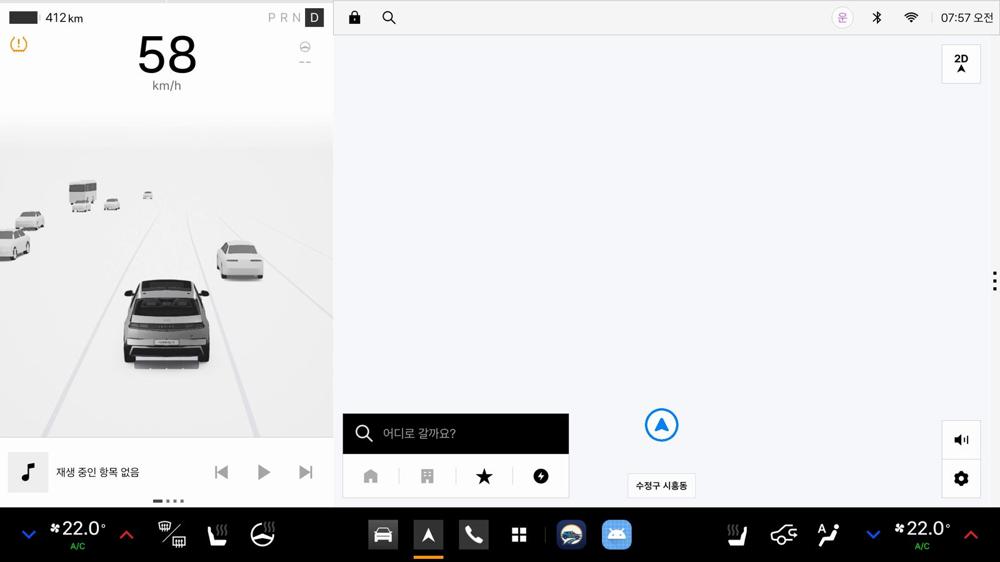
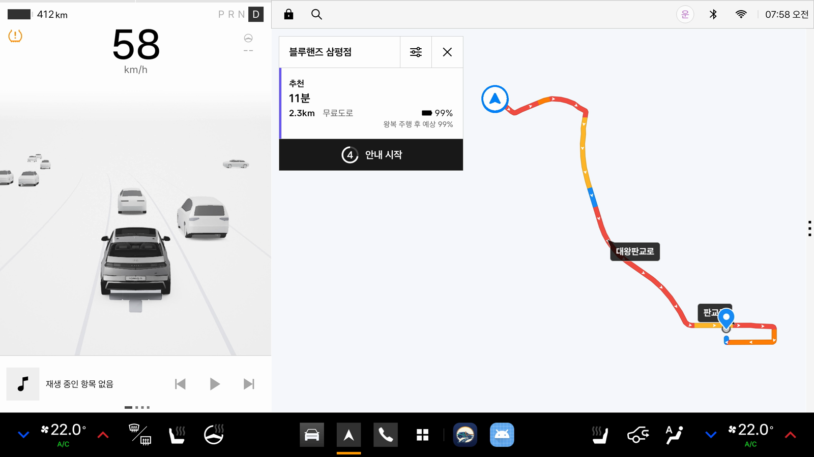
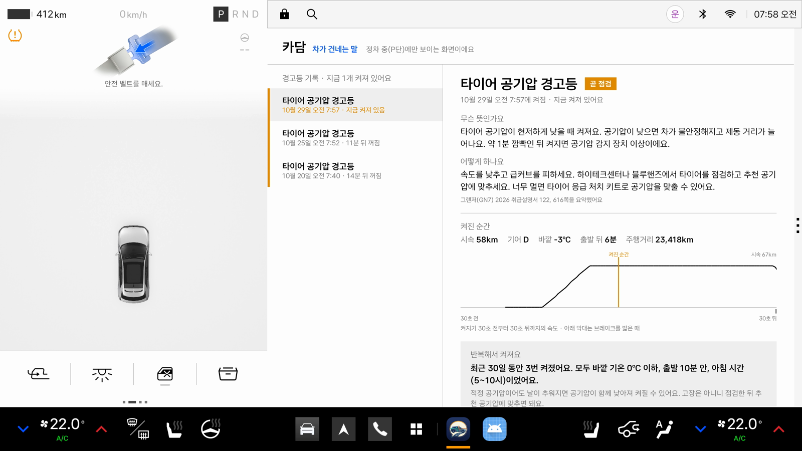
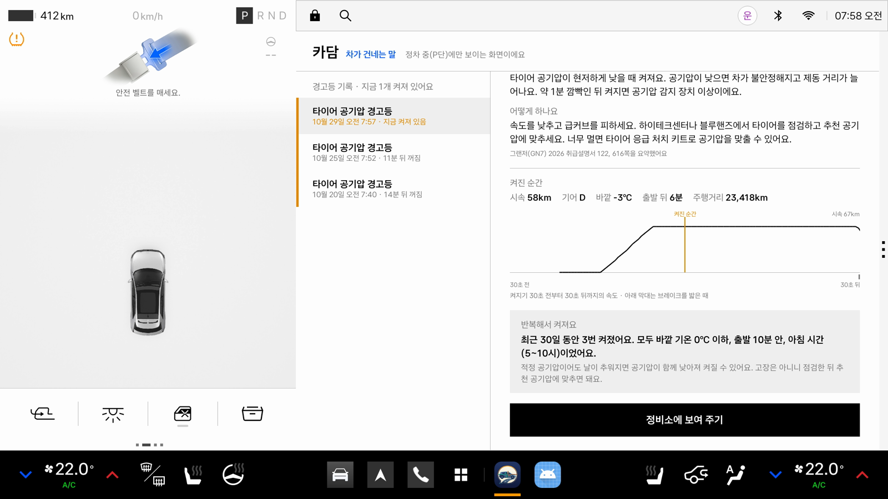
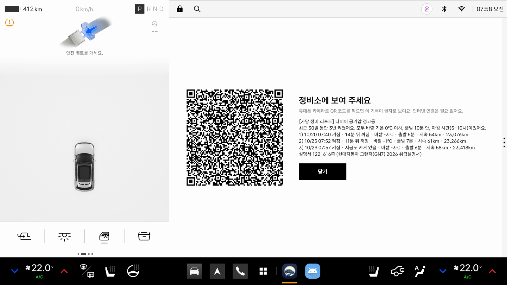

# 에뮬레이터 기능 검증 결과

Pleos Connect Emulator v2.1.0에서 앱의 핵심 기능을 시험한 결과입니다. 경고등과 차량 상태는 Virtual Console로 바꾸고, 운전자 대답은 미리 합성한 음성('네', '아니요')을 온디바이스 음성 인식기에 입력해 확인했습니다.

## 결과
| 확인 항목 | 결과 |
|---|---|
| Virtual Console 경고등 → 앱 수신 | 정상 (켜진 경고등만 목록으로 수신, 종류·켜짐/깜빡임·색 포함, 끄면 목록에서 제외) |
| 7초 이상 켜진 경고등만 안내, 시동 시 점등 확인과 구분 | 정상 (엔진 경고등 3초 켜짐 → 안내·기록 없음) |
| 표시등은 안내하지 않음 | 정상 (전조등 하향 표시등) |
| 색에 따라 판단하는 경고등 | 정상 (오토 홀드 초록 → 안내 없음, 노랑 → 곧 점검 안내) |
| 깜빡임과 계속 켜짐 구분 | 정상 (ESC 깜빡임 → 안내 없음, 계속 켜짐 → 곧 점검 안내) |
| 주행 중에만 경고인 경고등 | 정상 (브레이크 경고등: P단 → 안내 없음, D단 출발 → 바로 세우기 안내) |
| 주행 중 노란 경고등 → 안내 → "네" → 정비소 길안내 | 정상 (타이어 공기압 경고등, 시속 58km → "가까운 정비소로 길안내할까요?" → "네" → "블루핸즈 삼평점을 안내할게요. 약 2킬로미터 거리예요." → 내비 경로 2.3km) |
| 정비소 제안에 "아니요" | 정상 ("알겠어요. 정차하면 화면에서 다시 볼 수 있어요.") |
| 주행 중 빨간 경고등 → 질문 없이 바로 세우기 안내 | 정상 (엔진 오일 압력 경고등, 시속 60·90km) |
| 바로 세우기 경고 뒤 정차 → 다시 안내 | 정상 (P단 2초 뒤 "차를 세웠어요. 엔진 오일 압력 경고등 대처 방법과 켜진 순간의 기록은 화면에서 볼 수 있어요.") |
| 주행 중 경고등이 꺼지면 기록 | 정상 ("타이어 공기압 경고등이 꺼졌어요. 기록해 뒀어요.", 켜져 있던 시간 기록) |
| 켜진 순간 기록 | 정상 (시속 58km, D단, 바깥 -3℃, 출발 6분, 주행거리 23,418km, 앞뒤 30초 속도와 브레이크) |
| 같은 경고등 반복 | 정상 (세 번째 → "이 경고등은 최근 30일 동안 세 번째예요", 화면에 "모두 바깥 기온 0℃ 이하, 출발 10분 안, 아침 시간이었어요"와 설명서 616쪽 추위 안내. 지난 두 번은 시연 명령으로 추가) |
| 정비소 리포트 QR 코드 | 정상 (화면 캡처의 QR을 ZXing으로 읽어 한글 리포트가 그대로 나오는 것 확인, 인터넷 연결 불필요) |
| 앱이 꺼져 있던 동안 켜진 경고등 | 정상 (서비스 종료 → 주행 중 엔진 경고등 켜짐 → 앱 재시작 → "앱이 꺼져 있던 동안 켜진 경고등이 있어요. 엔진 경고등이 켜졌어요…" → 정비소 제안) |
| 앱 재시작 시 이미 켜져 있던 경고등 | 정상 (타이어 공기압·엔진 오일 압력 경고등을 '앱이 꺼져 있던 동안 켜짐'으로 기록) |
| 전원 꺼짐 → 켜짐 후 서비스 자동 시작 | 정상 (앱 실행 없이 부팅 완료 후 2초) |
| 기록 유지 | 정상 (앱 재설치·재시작 후에도 기록 유지) |
| 정차 화면 | 정상 (주행 중 시스템 차단과 앱 자체 가림 화면, P단에서 기록 목록·설명·켜진 순간·반복 패턴·리포트 표시) |

## 확인한 제약
- 경고등 정보는 `pleos.car.permission.PRIVATE_CAR_SAFETY` 권한이 있어야 읽을 수 있습니다(`CAR_SAFETY`만으로는 SecurityException).
- SDK는 경고등 95가지를 구분하지만 Virtual Console로 켤 수 있는 경고등은 37가지입니다. 연료 부족, 운전자 주의 경고 등은 에뮬레이터에서 시험하지 못했습니다.
- 에뮬레이터는 타이어 공기압 수치, 연료량, 엔진 오일양 값을 보내지 않습니다. 차대번호는 '"invalid"'를 보내며, 앱은 17자리가 아니면 표시하지 않습니다.
- 에뮬레이터를 켠 뒤 내비게이션 앱을 한 번도 열지 않으면 현재 위치를 응답하지 않아 정비소를 찾지 못합니다("지금 위치를 알 수 없어서 정비소를 찾지 못했어요."). 내비게이션을 한 번 열면 정상입니다.
- 실제 Suspend(절전)는 에뮬레이터에서 재현할 수 없어 서비스 종료와 재시작으로 대신 시험했습니다.

## 화면
| 계기판 경고등과 주행 중 안내 | "네" → 블루핸즈 길안내 |
|---|---|
|  |  |

| 정차 화면: 켜진 순간 기록 | 정차 화면: 반복 패턴 |
|---|---|
|  |  |

| 정비소 리포트 (QR) |
|---|
|  |
